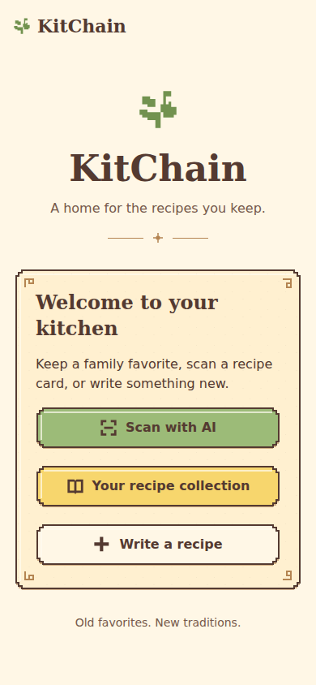
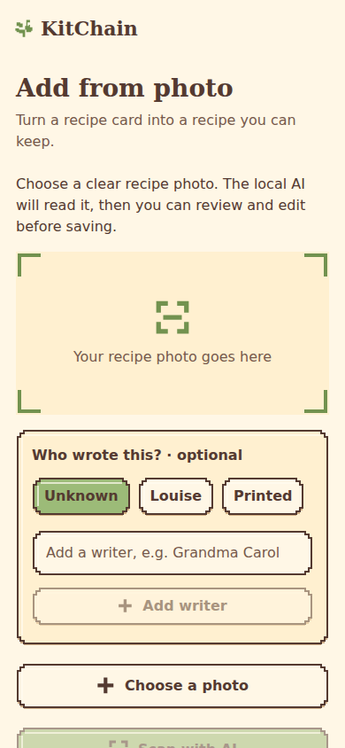
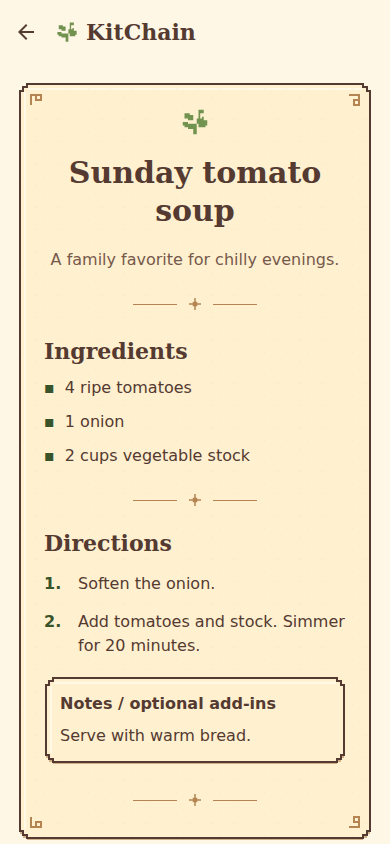
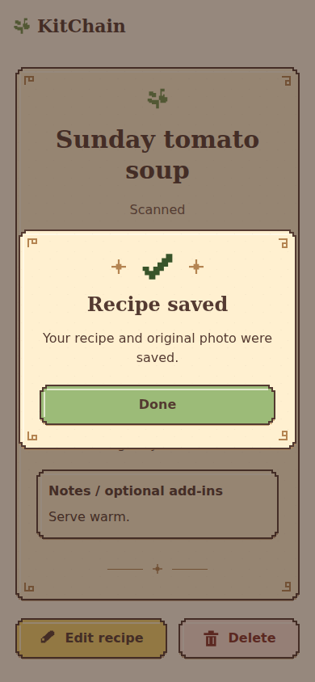

# Warm-kitchen visual pass

Daniel approved the warm ivory/parchment/herb concept sheet on October 16, 2026 Pacific. This pass applies that direction to home, recipe collection/search, manual creation, photo selection/scanning/review, recipe detail/editing, and application confirmation/error dialogs.

## Browser previews

These are rendered screens with synthetic recipes and an empty artwork registry.

| Home | Scan a recipe |
| --- | --- |
|  |  |

| Recipe page | Saved popup |
| --- | --- |
|  |  |

## Implementation

- Shared palette and dark espresso text, serif headings, herb-green primary actions, butter-yellow secondary actions, and tomato/error accents.
- Responsive stepped pixel borders with stable-size corners, inset highlights, decorative parchment grain/corner flourishes, and shallow pressed-button movement. The frames grow with live content; backgrounds are not stretched screenshots.
- Recipe cards with a framed photo area, full recipe parchment pages, scanner brackets/read line, search/clear control, and success check/sparkles.
- Existing confirm/save callbacks now run through a shared modal queue. Replace, rescan, discard, and delete still require their original confirmation choices. No mutation is bound to the backdrop. Back dismisses a cancel action where one exists; otherwise a single-button notice can be dismissed.
- Existing haptics, disabled/busy states, scan stop/timeout controls, review fields and storage notices remain.
- New art slots and optional same-canvas PNG frame playback, with a reduced-motion poster. All user-art entries remain null. See [the asset handoff](PIXEL_ART.md).
- SVG uses Expo SDK 57's compatible `react-native-svg` version. A custom development build must include this native dependency. Expo Go testing is still a separate phone check.

The AI/model/prompt, API routes, photo-upload fix, recipe data, and draft-storage implementation are unchanged by this visual pass. The only API-helper import remains the tested explicit Expo fetch from master.

## Validation

- TypeScript, ESLint, 19 existing frontend regression tests, and Expo Doctor's 21 checks pass.
- iOS/Android Hermes bundle exports and web static export pass.
- Browser checks use real rendered web screens at 320, 390, 768 and 1280 pixels with synthetic API responses: home navigation, search/clear, recipe detail, edit Cancel, delete Cancel/confirm, manual validation/save, writer selection, photo selection, scanning/review/rescan Cancel/save, popup queue and success callback navigation. No page exceptions or horizontal overflow were observed in the exercised screens.
- Screenshots use synthetic recipe records, not personal data. They document the browser rendering and do not establish native-device rendering or actual AI recognition.
- The main text pairs meet at least 4.5:1 calculated contrast: espresso/herb 4.83, espresso/butter 7.30, espresso/ivory 9.72, muted/paper 5.64, error ink/error paper 7.08. This is not a full accessibility audit.

## Try it

```bash
git fetch origin
git switch codex/kitchain-kitchen-art
git pull --ff-only
cd app
npm ci
npx expo start --clear
```

Keep the backend and Ollama running as usual. On a phone, verify keyboard scrolling, long recipe text, large system text, safe-area/header spacing, confirmations, haptics, scanning, and save/recovery. Native dialog focus and the actual artwork's sharpness/motion still need phone checks. The interface uses the approved light parchment palette in its main screens.

## Reproduce browser checks

The optional browser harness uses Playwright and the synthetic fixture in `tests/fixtures/recipe.png`. It intercepts API requests, so it never writes real recipes or invokes Ollama. Install Playwright locally without changing the project lockfile, then run from `app`:

```bash
npm install --no-save --package-lock=false playwright
npx playwright install chromium
CI=1 EXPO_PUBLIC_API_BASE=http://127.0.0.1:8028 npx expo export --platform web
npm run test:ui
```

`KITCHAIN_WEB_EXPORT` can point at a different export directory; `ART_PREVIEW_DIR` controls screenshot output. `PLAYWRIGHT_MODULE_PATH` and `CHROMIUM_EXECUTABLE` support an existing browser runtime. The harness serves the export itself on localhost port 8027. Phone behavior still needs its own check.
